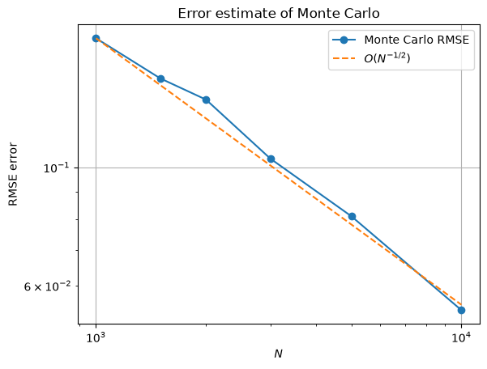
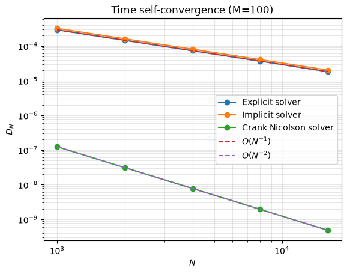
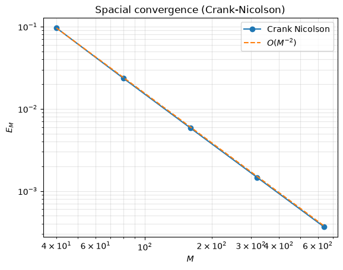

# Black–Scholes European Put Pricing: Numerical Methods

A Python project comparing **Black–Scholes analytical pricing**, **Monte Carlo simulation**, and three **finite-difference PDE solvers** for a non-dividend-paying European put option.

The main goals are to implement the numerical methods, validate them against the analytical benchmark, and investigate **convergence orders, numerical error, and runtime**.

## Methods

| Method | Description | Expected temporal order |
| --- | --- | --- |
| Black–Scholes formula | Closed-form benchmark | — |
| Monte Carlo | Risk-neutral terminal-stock simulation | RMSE $O(n^{-1/2})$ in the number of simulations |
| Explicit finite difference | Explicit spatial update, implicit treatment of the discount term | 1 |
| Implicit finite difference | Backward Euler time discretization | 1 |
| Crank–Nicolson | Trapezoidal time discretization | 2 |

The finite-difference methods all use **central differences in space**, which are formally second-order accurate for smooth solutions. The spatial convergence test in this project is conducted with Crank–Nicolson.

## Mathematical model

Under the risk-neutral measure, the non-dividend-paying stock follows geometric Brownian motion:

$$
dS_t = rS_t\,dt+\sigma S_t\,dW_t.
$$

The Black–Scholes PDE for a European put price $P(t,S)$ is

$$
P_t+\frac{1}{2}\sigma^2 S^2P_{SS}+rSP_S-rP=0.
$$

The terminal payoff and computational boundary conditions are

$$
\begin{aligned}
P(T,S)&=(K-S)^+,\\
P(t,0)&=Ke^{-r(T-t)},\\
P(t,S_{\max})&\approx 0.
\end{aligned}
$$

The last condition is a truncation approximation for sufficiently large $S_{\max}$.

### Analytical benchmark

$$
P_{\mathrm{BS}}=Ke^{-rT}\Phi(-d_2)-S_0\Phi(-d_1),
$$

where

$$
d_1=\frac{\ln(S_0/K)+(r+\sigma^2/2)T}{\sigma\sqrt{T}},
\qquad d_2=d_1-\sigma\sqrt{T},
$$

and $\Phi$ denotes the standard normal CDF.

### Monte Carlo estimate

Sampling $Z_k\sim N(0,1)$, the terminal stock prices are generated directly from the exact GBM solution:

$$
S_T^{(k)}=S_0\exp\left[\left(r-\frac{\sigma^2}{2}\right)T+
\sigma\sqrt{T}\,Z_k\right].
$$

The estimator is

$$
\widehat P_{\mathrm{MC}}
=\frac{e^{-rT}}{n}\sum_{k=1}^n (K-S_T^{(k)})^+.
$$

Because the European payoff depends only on $S_T$, there is no need to simulate a full path.

### Finite-difference discretization

Let $S_j=j\Delta S$, $t_i=i\Delta t$, with $\Delta S=S_{\max}/M$ and $\Delta t=T/N$. Denote the central-difference spatial operator by $L_h$.

The three time-stepping methods are:

**Explicit (with an implicit discount term)**

$$
\frac{P_{i+1,j}-P_{i,j}}{\Delta t}
+L_hP_{i+1,j}+rP_{i+1,j}-rP_{i,j}=0.
$$

**Implicit**

$$
P_i=P_{i+1}+\Delta t\,L_hP_i.
$$

**Crank–Nicolson**

$$
P_i=P_{i+1}+\frac{\Delta t}{2}(L_hP_i+L_hP_{i+1}).
$$

Here the vector notation suppresses known boundary contributions. The implicit and Crank–Nicolson schemes require solving a tridiagonal linear system at every time step.

Detailed finite-difference coefficients, matrices, and boundary adjustments are derived in [`experiments.ipynb`](experiments.ipynb).

## Numerical experiments

The notebook uses a five-month European put with the following **numerical input values**:

| Parameter | Value |
| --- | ---: |
| Initial stock price $S_0$ | 50 |
| Strike $K$ | 50 |
| Risk-free rate $r$ | 0.10 |
| Volatility $\sigma$ | 0.40 |
| Maturity $T$ | 0.4167 years |
| Truncated domain $S_{\max}$ | 200 |

The analytical put price for these inputs is approximately **4.076101**.

### 1. Monte Carlo convergence

For each sample size $n\in\lbrace  1000,1500,2000,3000,5000,10000 \rbrace$, the notebook repeats the Monte Carlo estimator **500 times** and calculates empirical root mean squared error (RMSE) relative to the analytical price:

$$
\mathrm{RMSE}(n)=\sqrt{\frac{1}{R}\sum_{\ell=1}^R
\left(\widehat P_n^{(\ell)}-P_{\mathrm{BS}}\right)^2},
\qquad R=500.
$$

The RMSE decreases at a rate consistent with $O(n^{-1/2})$. A log-log fit of the displayed RMSE values gives an approximate slope of **−0.51**.



### 2. Temporal self-convergence

Keep $M=100$ fixed and refine the temporal grid:

$$
N\in\lbrace1000,2000,4000,8000,16000,32000\rbrace.
$$

To isolate temporal convergence from the fixed spatial error, compare results at successive time resolutions:

$$
D_N=\left|P_{M,N}(0,S_0)-P_{M,2N}(0,S_0)\right|,
\qquad
p_N=\log_2\left(\frac{D_N}{D_{2N}}\right).
$$

Observed orders:

| Solver | Observed temporal convergence order |
| --- | ---: |
| Explicit | Approximately 1.0000 |
| Implicit | Approximately 1.0000 |
| Crank–Nicolson | Approximately 2.0000 |



These results support first-order temporal convergence for the explicit and implicit schemes and second-order temporal convergence for Crank–Nicolson.

### 3. Spatial convergence

Use the Crank–Nicolson solver with $N=42000$ fixed, refining the spatial grid:

$$
M\in\lbrace40,80,160,320,640\rbrace.
$$

Define the pointwise error against the analytical price as

$$
E_M=\left|P_{M,N}(0,S_0)-P_{\mathrm{BS}}\right|,
\qquad
q_M=\log_2\left(\frac{E_M}{E_{2M}}\right).
$$

| Spatial refinement | Estimated order |
| --- | ---: |
| 40 → 80 | 2.03231 |
| 80 → 160 | 2.00744 |
| 160 → 320 | 2.00183 |
| 320 → 640 | 2.00046 |

The observed order approaches **2**, consistent with the central-difference spatial discretization.



### 4. Pricing and runtime comparison

For the PDE solvers, use $M=200$, $N=8000$, and $S_{\max}=200$. The Monte Carlo estimate uses **3000 simulated terminal values**.

The notebook records the following **single-run** results:

| Method | Price | Absolute error vs. BS | Runtime (s) |
| --- | ---: | ---: | ---: |
| Black–Scholes analytical | 4.076101 | 0 | — |
| Monte Carlo | 3.940203	 | 0.135898 | 0.000253 |
| Explicit | 4.072431 | 0.003670 | 0.040497 |
| Implicit | 4.072278 | 0.003823 | 0.236387 |
| Crank–Nicolson | 4.072358 | 0.003743 | 0.282068 |

For this Monte Carlo run, the reported standard error is **0.105127**, with a **95% confidence interval** of **[3.734154, 4.146251]**, which contains the analytical price.

**Interpretation:** These runtimes depend on the environment, implementation, and different computational settings for Monte Carlo and PDE methods; they are illustrative rather than a controlled performance benchmark. The slightly smaller error of the explicit solver in this particular comparison does not contradict Crank–Nicolson's higher *temporal* convergence order: all PDE solvers retain spatial discretization error, and errors can partially cancel.

## Repository structure

```text
black-scholes-engine/
├── analytic.py
├── monte_carlo.py
├── finite_difference.py
├── experiments.ipynb
├── figures/
│   ├── monte_carlo_rmse.png
│   ├── temporal_convergence.png
│   └── spatial_convergence.png
└── README.md
```

The Python modules are imported by the notebook. Place the modules and `experiments.ipynb` in the repository root as shown above.

## Running the experiments

1. Create and activate a Python virtual environment.
2. Install the numerical and notebook dependencies:

   ```bash
   python -m pip install numpy scipy matplotlib pandas jupyter ipython
   ```

3. Launch the notebook:

   ```bash
   jupyter notebook experiments.ipynb
   ```

4. Run the cells in order.

**Reproducibility notes:** Monte Carlo values and single-run timings will vary between executions. A fixed random seed (2026) is used in each Monte Carlo experiment to ensure reproducible simulation results. Runtime measurements may vary across executions. The spatial convergence experiment uses a relatively large time-step count ($N=42000$) and can take longer than the other experiments.


## Related Project

This project builds upon my earlier work on
[Black-Scholes-Greeks](https://github.com/Huangteng-Yang/Black-Scholes-Greeks),
which focuses on option pricing and the numerical computation
of Greeks, including Delta and Vega.

The present project extends the numerical analysis to
finite difference PDE solvers, including explicit,
implicit, and Crank-Nicolson methods.

The main emphasis is on numerical stability, convergence
orders, pricing accuracy, and computational efficiency.

## Conclusions and limitations

- The empirical Monte Carlo RMSE follows the expected $O(n^{-1/2})$ scaling.
- Explicit and implicit finite-difference solvers show approximately first-order **temporal** convergence.
- Crank–Nicolson shows approximately second-order **temporal** convergence.
- Second-order **spatial** convergence is numerically demonstrated using Crank–Nicolson.
- The implicit and Crank–Nicolson implementations incur additional cost from solving tridiagonal systems; the measured runtime depends on implementation and grid settings.

This project focuses on a **European put** under the constant-volatility Black–Scholes model. It does not implement American early exercise, nonuniform spatial grids, or higher-order smoothing at the nonsmooth terminal payoff. Domain truncation and the payoff kink may influence error behavior outside the tested regimes.
